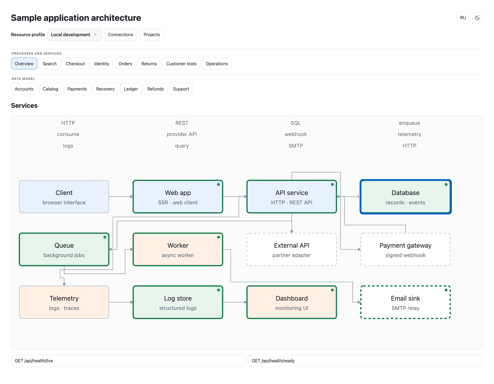
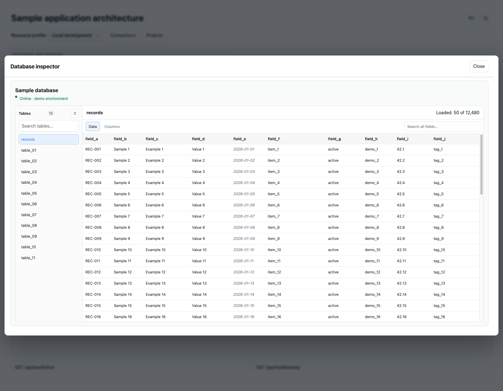

# Resource Inspector

Resource Inspector is a portable MCP server and a live-inspection panel for architecture maps generated with `project-architecture-map`. It adds status checks, logs, PostgreSQL previews, BullMQ queue summaries, and structured HTTP request history to the map itself.

## Screenshots

These screenshots use synthetic labels and sample rows; they contain no project names or customer data.





## Quick start

```sh
pnpm install
cp .env.example .env
mkdir -p .resource-inspector
cp profiles.example.json .resource-inspector/profiles.json
```

Edit `.resource-inspector/profiles.json` to match your container names, service health URLs, log labels, tables, and queues. Put defaults in `.env`; the viewer never edits that file. Then build and open the generated map through its local viewer:

```sh
pnpm --dir /path/to/resource-inspector build
pnpm --dir /path/to/resource-inspector map --map /absolute/path/to/architecture-map.html --config /path/to/project/.resource-inspector/profiles.json --env /path/to/project/.env
```

Open the printed `http://127.0.0.1:8765` URL. Click a bound node in the existing map to view service status and its available data. Status refreshes every 15 seconds while the node panel is open. The viewer serves the same generated map; it does not create a separate dashboard.

To manage several project maps from one screen, start the hub instead. It opens the project registry at `~/.resource-inspector/projects.json`; add, edit, and remove map/config/environment paths in the UI:

```sh
pnpm --dir /path/to/resource-inspector hub
```

## MCP client

Build the package before registering it. Register an MCP stdio server with command `pnpm` and arguments `--dir /path/to/resource-inspector mcp --config /absolute/path/to/profiles.json --env /absolute/path/to/.env`. It exposes `list_profiles`, `list_resources`, `resource_status`, `inspect_resource`, and `ask_services` tools.

`ask_services` accepts a natural-language question and an explicit `profileId`, then returns bounded evidence from that local or cloud profile: health checks, logs, request history, queue summaries, and database table names. The MCP host uses that evidence to answer; Resource Inspector does not execute shell commands, arbitrary SQL, queue jobs, or question-derived log queries.

For the multi-project hub, point MCP at the same registry used by the viewer:

```sh
node dist/cli.js mcp --projects ~/.resource-inspector/projects.json
```

That mode exposes `list_projects` and `ask_project`. `ask_project` scopes evidence collection to one registered project and the explicitly selected local or cloud profile. Database rows and queue job payloads are excluded from question summaries; use `inspect_resource` for an explicitly selected, allowlisted view.

## Profiles and secrets

Each profile is marked `local` or `cloud`, so the map's profile selector switches between them. Environment values load from `.env`, then process environment variables, then local replacements saved by the viewer. Settings show only whether a value is configured. Replacements are checked before they are saved to the project's `.resource-inspector/secrets.json` with owner-only permissions. The viewer treats `.env` as read-only.

Keep profile variable names unique across local and cloud profiles. This prevents an override for one environment from changing another environment's connection.

## Request history

The Loki connector shows existing structured `HTTP request completed` entries, including request ID, method, path, status, and duration. Reading existing logs requires no application changes. Capturing input/output bodies is an optional application integration, off by default, and should be added only when explicitly requested. Review redaction and log retention before enabling it. See [the request-history guide](skills/resource-inspector/references/request-history.md).

## Add a connector

Built-in connector types are `docker`, `http-health`, `postgres`, `bullmq`, and `loki`. Add a project-local JavaScript module with an exported `registerConnectors(environment)` function, then list its relative path in the profile document's top-level `connectorModules` array. The module's code runs in the MCP process, so only load modules you trust. See [connector authoring](skills/resource-inspector/references/connector-authoring.md).

## Skill

The canonical `project-architecture-map` generator, template, scripts, and skill live in `integrations/project-architecture-map/skill`. Install that skill together with `skills/resource-inspector`; do not use a stale global generator. The Resource Inspector skill covers source inventory, profiles, map bindings, connectors, and live inspection. Request-history body capture remains optional. Follow the [interactive map quick start](integrations/project-architecture-map/README.md) to install both skills and build a clickable map.

## Development

```sh
pnpm typecheck
pnpm test
pnpm build
```
